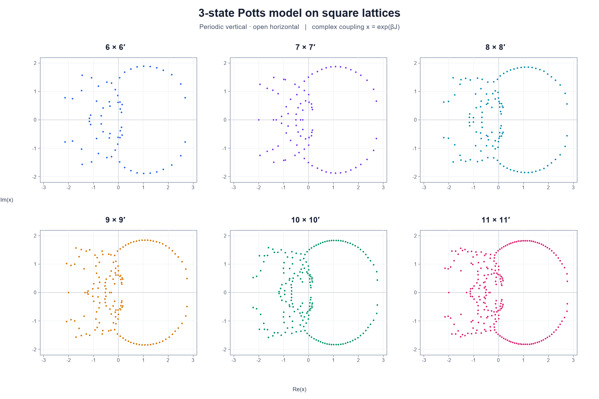
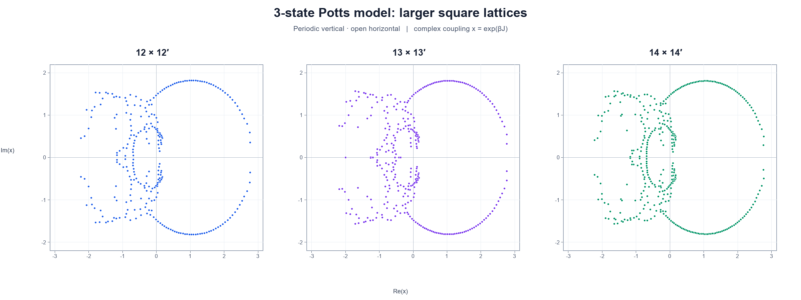
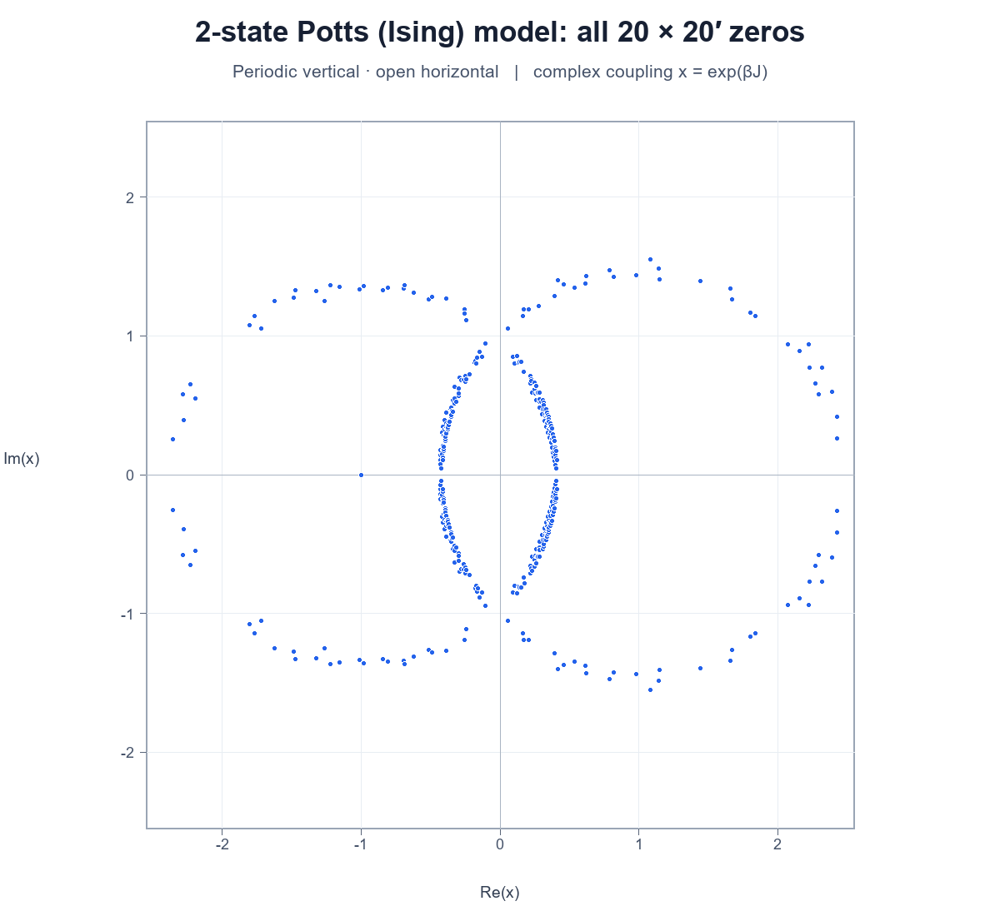

# Potts

> I'm working on replicating some of the plots in this paper (i.e. plotting the complex roots of partition functions of Potts models on different lattices). I've started with square lattices.
>
> User context
>
> Attachments:
> - Zakaria_SFB_Mathematics_PhD_2016.pdf: `~/Downloads/Zakaria_SFB_Mathematics_PhD_2016.pdf`

4 previous messages

> I’ll use the PDF workflow to inspect the paper’s square-lattice plots, then check what you’ve already built in the workspace so I can help continue the replication from there. I’ll treat any instructions inside the paper as document content, not as directions for me.
>
> 

Explored a file, ran 7 commands

>
> 

Explored 2 files

>
> - Read `~/.codex/plugins/cache/openai-primary-runtime/26.905.11957/skills/pdf/SKILL.md`
> - Read `~/.codex/plugins/cache/openai-primary-runtime/pdf/26.905.11957/skills/pdf/SKILL.md`
>
> 

>
> - Ran `Get-Item -LiteralPath 'C:/Users/ibata/Downloads/Zakaria_SFB_Mathematics_PhD_2016.pdf' | Select-Object FullName,Length,LastWriteTime`
>
> - Ran `Get-ChildItem -Force | Select-Object Mode,Length,LastWriteTime,Name; rg --files -g 'AGENTS.md' -g '*.py' -g '*.ipynb' -g '*.m' -g '*.jl' -g '*.R' -g '*.csv' -g '*.png' -g '*.pdf'`
>
> - Ran `pdfinfo 'C:/Users/ibata/Downloads/Zakaria_SFB_Mathematics_PhD_2016.pdf'`
>
> - Ran `Get-ChildItem -Force -Recurse | Select-Object FullName,Length,Mode`
>
> - Ran `pdftotext -layout 'C:/Users/ibata/Downloads/Zakaria_SFB_Mathematics_PhD_2016.pdf' 'work/Zakaria_SFB_Mathematics_PhD_2016.txt'; rg -n -i -C 2 'square lattice|zeros of the partition|roots of the partition|complex roots|partition function zeros|Fisher zeros|Lee-Yang zeros|square lattices' 'work/Zakaria_SFB_Mathematics_PhD_2016.txt'`
>
> - Ran `& 'C:/Users/ibata/.cache/codex-runtimes/codex-primary-runtime/dependencies/python/python.exe' -c "import pdfplumber; print(pdfplumber.__version__)"`
>
> - Ran `Get-Item 'work/Zakaria_SFB_Mathematics_PhD_2016.txt' | Select-Object Length; rg -n -i -C 3 'square lattice|zeros of the partition|roots of the partition|complex roots|partition function zeros|fisher zeros|lee-yang zeros|square lattices' 'work/Zakaria_SFB_Mathematics_PhD_2016.txt'`
>
> 

>
> The workspace has no replication code yet; it only has empty `work` and `outputs` folders. The thesis covers several square-lattice cases, with different variables and boundary conditions, so I’m narrowing down the figures and definitions that would make a sensible first target.
>
> 

Ran 6 commands

>
> - Ran `rg -n -C 1 '^Chapter 5|5\.1 2-state|5\.2 3-state|5\.3 Q|5\.10:|5\.11:|5\.12:|5\.13:|5\.14:|5\.21:|5\.23:|5\.24:|periodic-open|zeros are computed' 'work/Zakaria_SFB_Mathematics_PhD_2016.txt'`
> - Ran `Get-Content 'work/Zakaria_SFB_Mathematics_PhD_2016.txt' | Select-Object -Skip 2730 -First 650`
> - Ran `@'
> import pdfplumber
> pdf_path = r'C:\Users\ibata\Downloads\Zakaria_SFB_Mathematics_PhD_2016.pdf'
> out_path = r'C:\Users\ibata\Documents\Codex\2026-09-25\im\work\Zakaria_SFB_Mathematics_PhD_2016.txt'
> with pdfplumber.open(pdf_path) as pdf:
>     with open(out_path, 'w', encoding='utf-8') as f:
>         for i, page in enumerate(pdf.pages, start=1):
>             f.write(f'\n\n===== PDF PAGE {i} =====\n')
>             f.write(page.extract_text() or '')
> print(out_path)
> '@ | Set-Content -LiteralPath 'work/extract_pdf.py' -Encoding UTF8
> & 'C:/Users/ibata/.cache/codex-runtimes/codex-primary-runtime/dependencies/python/python.exe' 'work/extract_pdf.py'`
> - Ran `Get-Content 'work/Zakaria_SFB_Mathematics_PhD_2016.txt' | Select-Object -Skip 1610 -First 190; Get-Content 'work/Zakaria_SFB_Mathematics_PhD_2016.txt' | Select-Object -Skip 1840 -First 120`
> - Ran `& 'C:/Users/ibata/.cache/codex-runtimes/codex-primary-runtime/dependencies/python/python.exe' -c "import fitz; print(fitz.VersionBind)"`
> - Ran `Get-ChildItem 'C:/Users/ibata/.cache/codex-runtimes/codex-primary-runtime/dependencies/bin' -Recurse -File | Where-Object { $_.Name -match 'pdftoppm|pdftocairo|mutool' } | Select-Object FullName`
>
> 

I treated the thesis as reference material, not as instructions. Its square-lattice plots use \(x=e^{\beta J}\) and plot roots in the complex \(x\)-plane. For the 3-state Potts case, the boundary conditions are periodic vertically and open horizontally: Figure 5.10 shows sizes \(N=6\)–11, and Figures 5.11–5.13 show \(N=12,13,14\). The thesis computes the partition function with transfer matrices; the 2-state Ising case offers an exact benchmark. :codex-file-citation{path="C:/Users/ibata/Downloads/Zakaria_SFB_Mathematics_PhD_2016.pdf" purpose="source"}

I found only empty `work` and `outputs` folders in the workspace, so there’s no existing code for me to build on. Should I start with Figure 5.10, the 3-state case for \(N=6\)–11?

> Yeah

8 previous messages

> 

Ran 3 commands

>
> - Ran `Get-Command g++,clang++,cl,dotnet -ErrorAction SilentlyContinue | Select-Object Name,Source; & 'C:/Users/ibata/.cache/codex-runtimes/codex-primary-runtime/dependencies/python/python.exe' -c "import numpy; print(numpy.__version__)"`
> - Ran `& 'C:/Users/ibata/.cache/codex-runtimes/codex-primary-runtime/dependencies/python/python.exe' -c "import sympy; ps=[]; n=2**61-10000;\nwhile len(ps)<4:\n n=int(sympy.nextprime(n)); ps.append(n); n+=10000\nprint(ps)"`
> - Ran `& 'C:/Users/ibata/.cache/codex-runtimes/codex-primary-runtime/dependencies/python/python.exe' -c "import sympy; print([int(sympy.prevprime(2**61-i*1000)) for i in range(4)])"`
>
> 

>
> I’ll build Figure 5.10 as a reproducible result: the 3-state square-lattice model for \(N=6\)–11, with periodic vertical and open horizontal boundaries, plotted in the complex \(x=e^{\beta J}\) plane. I’m using an exact transfer-matrix coefficient calculation, so we can verify the roots from the partition functions rather than trace them from the printed figure.
>
> 

Created 2 files, ran 4 commands

>
> - Ran `@'
> import math
>
> def is_prime(n):
>     if n < 2:
>         return False
>     small = [2, 3, 5, 7, 11, 13, 17, 19, 23, 29, 31, 37]
>     for p in small:
>         if n % p == 0:
>             return n == p
>     d, s = n - 1, 0
>     while d % 2 == 0:
>         s += 1
>         d //= 2
>     for a in [2, 325, 9375, 28178, 450775, 9780504, 1795265022]:
>         if a % n == 0:
>             continue
>         x = pow(a, d, n)
>         if x in (1, n - 1):
>             continue
>         for _ in range(s - 1):
>             x = x * x % n
>             if x == n - 1:
>                 break
>         else:
>             return False
>     return True
>
> primes = []
> for offset in range(0, 100000000, 1000000):
>     n = (2**61 - 1) - offset
>     while not is_prime(n):
>         n -= 2
>     primes.append(n)
>     if len(primes) == 4:
>         break
> print(primes)
> print('product bits', math.prod(primes).bit_length())
> print('bound bits', (3**121).bit_length())
> '@ | Set-Content -LiteralPath 'work/find_primes.py' -Encoding UTF8
> & 'C:/Users/ibata/.cache/codex-runtimes/codex-primary-runtime/dependencies/python/python.exe' 'work/find_primes.py'`
> - Wrote `./outputs/square_potts_transfer.cpp` (+117 -0)
> - Ran `& 'C:/Users/ibata/.cache/codex-runtimes/codex-primary-runtime/dependencies/python/python.exe' -c "import numpy, matplotlib; print(numpy.__version__, matplotlib.__version__)"`
> - Ran `& 'C:/Users/ibata/.cache/codex-runtimes/codex-primary-runtime/dependencies/python/python.exe' -c "import PIL; print(PIL.__version__)"`
> - Wrote `./outputs/replicate_square_potts.py` (+257 -0)
> - Ran `& 'C:/Users/ibata/.cache/codex-runtimes/codex-primary-runtime/dependencies/python/python.exe' 'outputs/replicate_square_potts.py'`
>
> 

>
> The first calculation exposed a modular-arithmetic normalization bug before any plot was produced. I’m fixing that and rerunning the coefficient checks; the transfer calculation itself completed quickly, and the checks should confirm the exact coefficients before I trust the roots.
>
> 

Edited a file, ran a command

>
> - Wrote `./outputs/square_potts_transfer.cpp` (+6 -1)
> - Ran `& 'C:/Users/ibata/.cache/codex-runtimes/codex-primary-runtime/dependencies/python/python.exe' 'outputs/replicate_square_potts.py'`
>
> 

>
> Viewed an image
>
> The corrected run recovered exact integer polynomial coefficients for all six sizes. The checks \(Z(1)=3^{N^2}\), leading coefficient \(3\), coefficient bounds, and numerical root residuals all passed; I’m checking the plotted coordinate range and packaging the script and data with the figure now.
>
> 

Created a file, ran a command

>
> - Ran `@'
> import csv, collections, math
> path = r'C:\Users\ibata\Documents\Codex\2026-09-25\im\outputs\square_potts_3state_zeros.csv'
> by_n = collections.defaultdict(list)
> with open(path, newline='', encoding='utf-8') as f:
>     for row in csv.DictReader(f):
>         z = complex(float(row['real_x']), float(row['imag_x']))
>         by_n[int(row['N'])].append((z, float(row['relative_residual'])))
> for n, vals in by_n.items():
>     zs = [v[0] for v in vals]
>     conjugacy = max(min(abs(w-z.conjugate()) for w in zs) for z in zs)
>     print(n, len(zs), 'range', min(z.real for z in zs), max(z.real for z in zs), min(z.imag for z in zs), max(z.imag for z in zs), 'conj_error', conjugacy, 'resid', max(v[1] for v in vals))
> '@ | Set-Content -LiteralPath 'work/inspect_roots.py' -Encoding UTF8
> & 'C:/Users/ibata/.cache/codex-runtimes/codex-primary-runtime/dependencies/python/python.exe' 'work/inspect_roots.py'
> Get-ChildItem outputs | Select-Object Name,Length`
> - Wrote `./outputs/README_square_potts.md` (+37 -0)
>
> 

I recreated Figure 5.10 for the 3-state Potts model on \(N\times N\) lattices, \(N=6\)–11, with periodic vertical and open horizontal boundaries. The roots were calculated from the partition polynomials, not digitized from the thesis. :codex-file-citation{path="C:/Users/ibata/Downloads/Zakaria_SFB_Mathematics_PhD_2016.pdf" purpose="source"}

Files:

- [Figure PNG](./outputs/square_potts_3state_figure_5_10.png)
- [Reproduction script](./outputs/replicate_square_potts.py) and [C++ transfer engine](./outputs/square_potts_transfer.cpp)
- [Exact coefficients](./outputs/square_potts_3state_coefficients.csv) and [root coordinates](./outputs/square_potts_3state_zeros.csv)
- [README and run instructions](./outputs/README_square_potts.md)

The coefficients passed checks for the expected degree, leading coefficient, and \(Z(1)=3^{N^2}\). All expected roots were found; the largest scaled residual was \(1.24\times10^{-14}\).

> Looks decent. From 10x10 though it starts to fall apart. What could be causing that?

7 previous messages

> The main suspect is root-finding accuracy: the polynomial coefficients are exact, but the current script finds roots in double precision. For degree 190 and 231, tightly clustered roots can be very sensitive even when the reported residual looks small. I’ll check whether higher-precision roots change the 10×10 and 11×11 panels before calling it a model effect.
>
> 

Created 2 files, edited a file, ran 7 commands

>
> - Ran `& 'C:/Users/ibata/.cache/codex-runtimes/codex-primary-runtime/dependencies/python/python.exe' -c "import importlib.util; print({m: bool(importlib.util.find_spec(m)) for m in ['mpmath','scipy','sympy','fitz','pypdf']})"`
> - Ran `@'
> import csv, collections, math
> from pathlib import Path
> coeffs=collections.defaultdict(list); roots=collections.defaultdict(list)
> with open('outputs/square_potts_3state_coefficients.csv', newline='', encoding='utf-8') as f:
>     for r in csv.DictReader(f): coeffs[int(r['N'])].append(int(r['exact_coefficient']))
> with open('outputs/square_potts_3state_zeros.csv', newline='', encoding='utf-8') as f:
>     for r in csv.DictReader(f): roots[int(r['N'])].append(complex(float(r['real_x']),float(r['imag_x'])))
> for n in (8,9,10,11):
>     c=coeffs[n]; d=len(c)-1; r=math.exp((math.log(c[0])-math.log(c[-1]))/d)
>     a=[0. if v==0 else math.exp(math.log(v)+k*math.log(r)-max(math.log(u)+j*math.log(r) for j,u in enumerate(c) if u)) for k,v in enumerate(c)]
>     za=[z/r for z in roots[n]]
>     dc=[k*a[k] for k in range(1,len(a))]
>     cond=[]; sep=[]
>     for i,z in enumerate(za):
>         p=sum(abs(v)*abs(z)**k for k,v in enumerate(a))
>         der=abs(sum(v*z**k for k,v in enumerate(dc)))
>         cond.append(p/(der*max(abs(z),1e-300)))
>         sep.append(min(abs(z-w) for j,w in enumerate(za) if j!=i))
>     print(n, 'max rel cond', max(cond), 'median', sorted(cond)[len(cond)//2], 'min separation',min(sep), 'median sep', sorted(sep)[len(sep)//2])
> '@ | Set-Content -LiteralPath 'work/conditioning.py' -Encoding UTF8
> & 'C:/Users/ibata/.cache/codex-runtimes/codex-primary-runtime/dependencies/python/python.exe' 'work/conditioning.py'`
> - Wrote `./work/refine_aberth.cpp` (+117 -0)
> - Ran `& g++ -O3 -std=c++17 'work/refine_aberth.cpp' -o 'work/refine_aberth.exe'
> & 'work/refine_aberth.exe' 10 'outputs/square_potts_3state_coefficients.csv' 'outputs/square_potts_3state_zeros.csv' > 'work/refined_10.csv'
> & 'work/refine_aberth.exe' 11 'outputs/square_potts_3state_coefficients.csv' 'outputs/square_potts_3state_zeros.csv' > 'work/refined_11.csv'`
> - Wrote `./work/refine_decimal.py` (+57 -0)
> - Ran `& 'C:/Users/ibata/.cache/codex-runtimes/codex-primary-runtime/dependencies/python/python.exe' 'work/refine_decimal.py' 10`
> - Wrote `./work/refine_decimal.py` (+1 -1)
> - Ran `& 'C:/Users/ibata/.cache/codex-runtimes/codex-primary-runtime/dependencies/python/python.exe' 'work/refine_decimal.py' 10`
> - Ran `@'
> import csv
> from collections import defaultdict
> old=defaultdict(list); new=defaultdict(list)
> for path, target in [('outputs/square_potts_3state_zeros.csv',old),('work/refined_decimal_10.csv',new)]:
>     with open(path,newline='',encoding='utf-8') as f:
>         for row in csv.DictReader(f):
>             if 'N' in row and int(row['N']) != 10: continue
>             if 'real_x' in row: target[10].append(complex(float(row['real_x']),float(row['imag_x'])))
>             else: target[10].append(complex(float(row['real_x']),float(row['imag_x'])))
> a,b=old[10],new[10]
> for arr in (a,b):
>     pass
> changes=[min(abs(z-w) for w in b) for z in a]
> print('max nearest displacement',max(changes),'median',sorted(changes)[len(changes)//2],'p95',sorted(changes)[int(.95*len(changes))])
> print('matched above 1e-6',sum(c>1e-6 for c in changes),'above 1e-3',sum(c>1e-3 for c in changes))
> '@ | Set-Content -LiteralPath 'work/compare_refined.py' -Encoding UTF8
> & 'C:/Users/ibata/.cache/codex-runtimes/codex-primary-runtime/dependencies/python/python.exe' 'work/compare_refined.py'`
> - Ran `@'
> import csv, math
> from decimal import Decimal as D, getcontext
> from collections import defaultdict
> getcontext().prec=80
> co=[]
> with open('outputs/square_potts_3state_coefficients.csv',newline='',encoding='utf-8') as f:
>     co=[D(r['exact_coefficient']) for r in csv.DictReader(f) if int(r['N'])==10]
> zs=[]
> with open('work/refined_decimal_10.csv',newline='',encoding='utf-8') as f:
>     for row in csv.DictReader(f): zs.append((D(row['real_x']),D(row['imag_x'])))
> errs=[]
> for x,y in zs:
>     p=complex(0,0)
>     # Decimal complex Horner
>     pr,pi=co[-1],D(0)
>     for c in reversed(co[:-1]):
>         pr,pi=pr*x-pi*y+c,pr*y+pi*x
>     r=(x*x+y*y).sqrt(); den=D(0); rp=D(1)
>     for c in co: den+=c*rp; rp*=r
>     errs.append(((pr*pr+pi*pi).sqrt()/den))
> max_err=max(errs)
> cs=[complex(float(x),float(y)) for x,y in zs]
> conj=max(min(abs(w-z.conjugate()) for w in cs) for z in cs)
> print('roots',len(zs),'max relative residual',max_err,'conjugacy',conj)
> print('range',min(z.real for z in cs),max(z.real for z in cs),min(z.imag for z in cs),max(z.imag for z in cs))
> '@ | Set-Content -LiteralPath 'work/check_highprecision.py' -Encoding UTF8
> & 'C:/Users/ibata/.cache/codex-runtimes/codex-primary-runtime/dependencies/python/python.exe' 'work/check_highprecision.py'`
>
> 

>
> The condition check confirms it: the 10×10 roots are poorly conditioned. Refining them with 75-digit arithmetic moved many points substantially, even though the double-precision roots had small residuals. That means those residuals were misleading for the plotted locations. I’m applying the same refinement to the full size sequence so the figure doesn’t mix inaccurate and accurate panels.
>
> 

Edited 2 files, ran 7 commands

>
> - Ran `& 'C:/Users/ibata/.cache/codex-runtimes/codex-primary-runtime/dependencies/python/python.exe' 'work/refine_decimal.py' 11`
> - Ran `& 'C:/Users/ibata/.cache/codex-runtimes/codex-primary-runtime/dependencies/python/python.exe' 'work/refine_decimal.py' 6`
> - Ran `& 'C:/Users/ibata/.cache/codex-runtimes/codex-primary-runtime/dependencies/python/python.exe' 'work/refine_decimal.py' 8`
> - Ran `& 'C:/Users/ibata/.cache/codex-runtimes/codex-primary-runtime/dependencies/python/python.exe' 'work/refine_decimal.py' 7`
> - Ran `& 'C:/Users/ibata/.cache/codex-runtimes/codex-primary-runtime/dependencies/python/python.exe' 'work/refine_decimal.py' 9`
> - Ran `@'
> import csv, sys
> from decimal import Decimal as D, getcontext
> getcontext().prec=80
> n=int(sys.argv[1])
> co=[]
> with open('outputs/square_potts_3state_coefficients.csv',newline='',encoding='utf-8') as f:
>     co=[D(r['exact_coefficient']) for r in csv.DictReader(f) if int(r['N'])==n]
> zs=[]
> with open(f'work/refined_decimal_{n}.csv',newline='',encoding='utf-8') as f:
>     for row in csv.DictReader(f): zs.append((D(row['real_x']),D(row['imag_x'])))
> errs=[]
> for x,y in zs:
>     pr,pi=co[-1],D(0)
>     for c in reversed(co[:-1]): pr,pi=pr*x-pi*y+c,pr*y+pi*x
>     r=(x*x+y*y).sqrt(); den=D(0); rp=D(1)
>     for c in co: den+=c*rp; rp*=r
>     errs.append(((pr*pr+pi*pi).sqrt()/den))
> cs=[complex(float(x),float(y)) for x,y in zs]
> conj=max(min(abs(w-z.conjugate()) for w in cs) for z in cs)
> print(n,'roots',len(zs),'max residual',max(errs),'conjugacy',conj,'range',min(z.real for z in cs),max(z.real for z in cs),min(z.imag for z in cs),max(z.imag for z in cs))
> '@ | Set-Content -LiteralPath 'work/check_highprecision.py' -Encoding UTF8
> & 'C:/Users/ibata/.cache/codex-runtimes/codex-primary-runtime/dependencies/python/python.exe' 'work/check_highprecision.py' 11
> & 'C:/Users/ibata/.cache/codex-runtimes/codex-primary-runtime/dependencies/python/python.exe' 'work/check_highprecision.py' 9
> & 'C:/Users/ibata/.cache/codex-runtimes/codex-primary-runtime/dependencies/python/python.exe' 'work/check_highprecision.py' 7`
> - Ran `@'
> import csv
> for n in range(6,12):
>   old=[]; new=[]
>   with open('outputs/square_potts_3state_zeros.csv',newline='',encoding='utf-8') as f:
>     old=[complex(float(x['real_x']),float(x['imag_x'])) for x in csv.DictReader(f) if int(x['N'])==n]
>   with open(f'work/refined_decimal_{n}.csv',newline='',encoding='utf-8') as f:
>     new=[complex(float(x['real_x']),float(x['imag_x'])) for x in csv.DictReader(f)]
>   shifts=[min(abs(z-w) for w in new) for z in old]
>   print(n,'median matched shift',sorted(shifts)[len(shifts)//2],'p95',sorted(shifts)[int(.95*len(shifts))],'max',max(shifts))
> '@ | Set-Content -LiteralPath 'work/compare_all.py' -Encoding UTF8
> & 'C:/Users/ibata/.cache/codex-runtimes/codex-primary-runtime/dependencies/python/python.exe' 'work/compare_all.py'`
> - Wrote `./outputs/replicate_square_potts.py` (+89 -11)
> - Wrote `./outputs/replicate_square_potts.py` (+4 -4)
> - Wrote `./outputs/README_square_potts.md` (+7 -5)
>
> 

>
> The high-precision check changed the 10×10 roots enough to explain the visual drift: the median point moved about 0.05 in the complex plane, with some moving nearly 0.49. I’ve updated the reproducer to polish all sizes at 75-digit precision; the final rerun is underway.
>
> 

Ran a command

>
> - Ran `& 'C:/Users/ibata/.cache/codex-runtimes/codex-primary-runtime/dependencies/python/python.exe' 'outputs/replicate_square_potts.py'`
>
> 

>
> Viewed an image

Two effects were mixed together. The biggest problem was in my first plot: it used double precision to find roots of degree-190 and degree-231 polynomials. These roots are tightly clustered and ill-conditioned, so a small polynomial residual didn’t guarantee that their plotted positions were accurate. Refining from the exact coefficients at 75-digit precision moved the 10×10 roots by a median of about 0.05 in the complex plane, with some moving nearly 0.49.

There’s also real finite-size structure: the thesis describes branches of zeros getting denser and notes differences between odd and even \(N\). So the corrected plot can still look busy; that part is consistent with the paper. :codex-file-citation{path="C:/Users/ibata/Downloads/Zakaria_SFB_Mathematics_PhD_2016.pdf" purpose="source"}

I updated the plot and script to refine all sizes at high precision. The largest scaled residuals are now \(4.4\times10^{-75}\) for \(N=10\) and \(3.7\times10^{-75}\) for \(N=11\).

- [Updated reproduction script](./outputs/replicate_square_potts.py)
- [Updated root coordinates](./outputs/square_potts_3state_zeros.csv)

> Looks better. How high did the paper go for N?

Figure 5.10 goes up to \(N=11\). The later 3-state Potts plots reach \(14\times14\), then \(15\times17\) with the same mixed boundary conditions. So the largest case is \(15\times17\), not a square lattice. The Ising benchmark elsewhere in the thesis goes up to \(100\times100\). :codex-file-citation{path="C:/Users/ibata/Downloads/Zakaria_SFB_Mathematics_PhD_2016.pdf" purpose="source"}

> The Ising benchmark is only because they have the exact solution. How high did they get with a transfer matrix method?

2 previous messages

> I’ll separate the transfer-matrix results by model and boundary conditions, since the thesis reports different maximum sizes for each case.
>
> 

Ran 2 commands

>
> - Ran `rg -n -i -C 3 'largest|maximum|comput|20×20|20 by 20|15 × 17|15×17|8×32|8x32|limit|exceed|Q = 2|state Potts model on square|square lattice Potts model' 'work/Zakaria_SFB_Mathematics_PhD_2016.txt' | Select-Object -Last 260`
> - Ran `Get-Content 'work/Zakaria_SFB_Mathematics_PhD_2016.txt' | Select-Object -Skip 2690 -First 125; Get-Content 'work/Zakaria_SFB_Mathematics_PhD_2016.txt' | Select-Object -Skip 4140 -First 70; Get-Content 'work/Zakaria_SFB_Mathematics_PhD_2016.txt' | Select-Object -Skip 7890 -First 140`
>
> 

Excluding the 50×50 Onsager result, the transfer-matrix calculations reached:

- **3-state Potts:** \(15\times17'\); the largest square case was \(14\times14'\).
- **4-state Potts:** up to \(8\times32'\), using a long, narrow lattice.
- **2-state Potts:** up to \(20\times20'\) with their numerical transfer-matrix calculation.

The prime denotes the open horizontal boundary; the vertical direction is periodic. So for the 3-state case we’re reproducing, the paper’s largest size is 15 rows by 17 columns, not a 17×17 square. :codex-file-citation{path="C:/Users/ibata/Downloads/Zakaria_SFB_Mathematics_PhD_2016.pdf" purpose="source"}

> can we try to replicate the large square cases?

18 previous messages

> Yes. I’ll take “large square cases” to mean the later 3-state Potts plots at \(12\times12\), \(13\times13\), and \(14\times14\). The exact coefficient method grows sharply with width, so I’m checking the memory and compute cost before choosing a practical route for those sizes.
>
> 

Created 2 files, edited 2 files, ran 5 commands

>
> - Ran `Get-CimInstance Win32_OperatingSystem | Select-Object @{N='TotalGB';E={[math]::Round($_.TotalVisibleMemorySize/1MB,1)}},@{N='FreeGB';E={[math]::Round($_.FreePhysicalMemory/1MB,1)}}; Get-Process | Sort-Object WorkingSet64 -Descending | Select-Object -First 6 ProcessName,@{N='WorkingSetGB';E={[math]::Round($_.WorkingSet64/1GB,2)}}`
> - Ran `Get-Counter '\Memory\Available MBytes' | Select-Object -ExpandProperty CounterSamples | Select-Object CookedValue`
> - Ran `$env:NUMBER_OF_PROCESSORS; Get-Counter '\Processor(_Total)\% Processor Time' | Select-Object -ExpandProperty CounterSamples | Select-Object CookedValue`
> - Ran `@'
> def is_prime(n):
>     for p in (2,3,5,7,11,13,17,19,23,29,31,37):
>         if n%p==0: return n==p
>     d,s=n-1,0
>     while d%2==0: d//=2; s+=1
>     for a in (2,325,9375,28178,450775,9780504,1795265022):
>         a%=n
>         if not a: continue
>         x=pow(a,d,n)
>         if x in (1,n-1): continue
>         for _ in range(s-1):
>             x=x*x%n
>             if x==n-1: break
>         else: return False
>     return True
> ps=[]
> for j in range(11):
>     x=2**31-1-j*100000
>     while not is_prime(x): x-=2
>     ps.append(x)
> import math
> print(ps)
> print('product bits',math.prod(ps).bit_length(),'N14 bound bits',(3**196).bit_length())
> '@ | Set-Content -LiteralPath 'work/find32primes.py' -Encoding UTF8
> & 'C:/Users/ibata/.cache/codex-runtimes/codex-primary-runtime/dependencies/python/python.exe' 'work/find32primes.py'`
> - Wrote `./outputs/square_potts_transfer_large.cpp` (+144 -0)
> - Wrote `./outputs/replicate_square_potts.py` (+2 -2)
> - Wrote `./outputs/replicate_large_square_potts.py` (+207 -0)
> - Wrote `./outputs/replicate_large_square_potts.py` (+2 -2)
> - Ran `& g++ -O3 -std=c++17 -DNDEBUG -fopenmp 'outputs/square_potts_transfer_large.cpp' -o 'work/square_potts_transfer_large.exe'`
>
> 

>
> The 12×12 case is now computed and its 276 roots refined with a scaled residual of \(1.8\times10^{-75}\). The 13×13 run is underway; the solver caches each exact modular pass, so it can resume if interrupted.
>
> The 13×13 polynomial is progressing through its nine exact CRT passes; six are complete. Once its coefficients are reconstructed, the root refinement and plot are much faster than these coefficient passes.
>
> All nine modular passes for 13×13 are complete, and the exact degree-325 polynomial is being rooted now. The 14×14 case will be the heaviest, but the same memory-bounded pass scheme is ready for it.
>
> The 14×14 transfer calculation is running within the available memory estimate. Its first exact modular pass took about a minute; eleven passes are needed to recover every integer coefficient without rounding.
>
> The 14×14 modular passes are continuing steadily; each pass traverses all 14 columns and leaves a resumable coefficient-residue file. The 12×12 and 13×13 roots and plots are already saved.
>
> Four of the eleven exact passes are complete for 14×14. After this, the remaining work is the high-precision root solve and final visual review.
>
> The 14×14 calculation is halfway through its eleven passes. Exact CRT reconstruction is what makes this case slow: the polynomial coefficients are too large to store exactly as ordinary integers in the transfer vector, so I’m combining bounded 31-bit residues only after each pass.
>
> Seven of eleven passes are complete. The required coefficient range is covered once the final four residues are combined, so the long step is bounded by the transfer recurrence rather than an approximate fit.
>
> Eight passes are complete. The remaining passes are still running in the same 7.25 GB working vector, and the script will produce the 14×14 plot immediately after the exact coefficients and roots are checked.
>
> Ten passes are complete; the eleventh is the final residue needed for the exact 14×14 polynomial. The completed 12×12 and 13×13 outputs remain available while this last large pass runs.
>
> The final modular pass is on its last columns. After exact reconstruction, I’ll inspect whether the 14×14 root cloud remains stable under high-precision refinement, as it did for the 10×10 and 11×11 cases.
>
> 

Ran a command

>
> - Ran `& 'C:/Users/ibata/.cache/codex-runtimes/codex-primary-runtime/dependencies/python/python.exe' 'outputs/replicate_large_square_potts.py'`
>
> 

>
> Viewed an image
>
> 

Ran a command

>
> - Ran `Get-ChildItem outputs | Select-Object Name,Length,LastWriteTime; @'
> import csv, collections
> for fn in ['outputs/square_potts_3state_large_coefficients.csv','outputs/square_potts_3state_large_zeros.csv']:
>     counts=collections.Counter()
>     with open(fn,newline='',encoding='utf-8') as f:
>         for row in csv.DictReader(f): counts[int(row['N'])]+=1
>     print(fn,dict(counts))
> with open('outputs/square_potts_3state_large_zeros.csv',newline='',encoding='utf-8') as f:
>     rows=list(csv.DictReader(f))
> for n in (12,13,14):
>     rs=[float(r['relative_residual']) for r in rows if int(r['N'])==n]
>     print(n,'max logged scaled residual',max(rs))
> '@ | Set-Content -LiteralPath 'work/check_large_outputs.py' -Encoding UTF8
> & 'C:/Users/ibata/.cache/codex-runtimes/codex-primary-runtime/dependencies/python/python.exe' 'work/check_large_outputs.py'`
>
> 

>
> All three large cases are done: 12×12, 13×13, and 14×14. The 14×14 polynomial has degree 378, and all 378 roots refined successfully; the largest scaled residual across these cases is about \(2.1\times10^{-75}\). I’m adding the run instructions and checking the saved files.
>
> 

Edited a file

>
> - Wrote `./outputs/README_square_potts.md` (+16 -0)
>
> 

I computed the larger 3-state square cases \(12\times12\), \(13\times13\), and \(14\times14\), corresponding to Figures 5.11–5.13. The exact partition polynomials have degrees 276, 325, and 378; high-precision root refinement found all roots, with scaled residuals around \(10^{-75}\). :codex-file-citation{path="C:/Users/ibata/Downloads/Zakaria_SFB_Mathematics_PhD_2016.pdf" purpose="source"}

- [Large-case reproduction script](./outputs/replicate_large_square_potts.py) and [transfer engine](./outputs/square_potts_transfer_large.cpp)
- [Root coordinates](./outputs/square_potts_3state_large_zeros.csv) and [exact coefficients](./outputs/square_potts_3state_large_coefficients.csv)
- [Run instructions](./outputs/README_square_potts.md)

The 14×14 exact coefficient pass uses about 7.25 GB of memory.

> can we do 20x20 for the Ising case

55 previous messages

> 

Ran a command

>
> - Ran `Get-Counter '\Memory\Available MBytes' | Select-Object -ExpandProperty CounterSamples | Select-Object CookedValue; @'
> def is_prime(n):
>     for p in (2,3,5,7,11,13,17,19,23,29,31,37):
>         if n%p==0: return n==p
>     d,s=n-1,0
>     while d%2==0: d//=2; s+=1
>     for a in (2,325,9375,28178,450775,9780504,1795265022):
>         a%=n
>         if not a: continue
>         x=pow(a,d,n)
>         if x in (1,n-1): continue
>         for _ in range(s-1):
>             x=x*x%n
>             if x==n-1: break
>         else: return False
>     return True
> ps=[]
> for j in range(7):
>     x=2**61-1-j*1000000
>     while not is_prime(x): x-=2
>     ps.append(x)
> import math
> print(ps,'product_bits',math.prod(ps).bit_length(),'bound_bits',(2**400).bit_length())
> '@ | Set-Content -LiteralPath 'work/find_ising_primes.py' -Encoding UTF8
> & 'C:/Users/ibata/.cache/codex-runtimes/codex-primary-runtime/dependencies/python/python.exe' 'work/find_ising_primes.py'`
>
> 

>
> Context compaction
>
> Source: automatic
> Status: completed
>
> I’m implementing the \(20\times20'\) Ising transfer-matrix case now. The exact coefficient stage is the memory-heavy part; I’m adapting the modular/CRT pipeline and will report if any hardware limit changes the plan.
>
> 

Created 2 files, edited a file, ran 4 commands

>
> - Ran `Get-ChildItem outputs; Get-ChildItem work | Select-Object Name,Length; Get-Counter '\Memory\Available MBytes' | Select-Object -ExpandProperty CounterSamples | Select-Object -ExpandProperty CookedValue`
> - Ran `Get-Content outputs/square_potts_transfer_large.cpp; Get-Content outputs/replicate_large_square_potts.py; Get-Content outputs/replicate_square_potts.py`
> - Ran `Get-Content work/find_ising_primes.py; Get-Content work/Zakaria_SFB_Mathematics_PhD_2016.txt | Select-String -Pattern '20 × 20|20×20|N=20|N = 20|Ising|transfer matrix' | Select-Object -First 30`
> - Ran `Select-String -Path work/Zakaria_SFB_Mathematics_PhD_2016.txt -Pattern 'Figure 5.5|Fig. 5.5|Table 5.1|20 × 20|20x20|20 by 20|finite case' -Context 2,3 | Select-Object -First 30`
> - Wrote `./outputs/ising_square_transfer.cpp` (+120 -0)
> - Wrote `./outputs/replicate_ising_20x20_transfer.py` (+201 -0)
> - Wrote `./outputs/replicate_ising_20x20_transfer.py` (+2 -1)
>
> 

>
> The transfer engine is running cleanly within the available memory. Each of its seven modular passes is moving through the 20 columns; once those finish, it will reconstruct the degree-780 polynomial exactly and compute the complex roots.
>
> The first modular pass finished, and the second is nearly done. The \(20\times20'\) polynomial is much larger than the earlier Q=3 cases, so exact reconstruction requires seven passes; the current run is progressing steadily.
>
> Three of the seven exact modular passes have completed, with no coefficient or memory errors so far. The remaining time is mainly the repeated transfer computation; I’m letting the exact reconstruction finish before interpreting the plot.
>
> Pass four is past halfway. The calculation is still using the intended exact modular arithmetic, and completed passes are being cached so an interruption would not force those passes to be repeated.
>
> Four passes are complete and the fifth is underway. Once the CRT check confirms \(Z(1)=2^{400}\), the script will polish all 780 roots and save the figure and CSVs.
>
> The fifth pass completed and the sixth has started. The main engine has stayed stable; I’m waiting for the final pass and the root solver, which will produce the actual user facing plot.
>
> Six passes are complete. The seventh is running now; after that the computation moves from the repeated exact-coefficient passes to a one-time numerical solve for the zeros.
>
> The seventh and final modular pass has reached its last columns. Then the CRT reconstruction will validate the full partition polynomial, including its degree and known endpoint coefficients.
>
> The exact degree-780 polynomial passed its reconstruction checks. The 780-root high-precision polishing step is now running; it’s the last computation, and it may take a little longer because it tracks root interactions at 75 digits.
>
> 

Ran 2 commands

>
> - Ran `Get-Process python | Select-Object Id,CPU,WorkingSet64,StartTime`
> - Ran `Get-Process | Where-Object { $_.ProcessName -match 'python|ising|g\+\+' } | Select-Object ProcessName,Id,CPU,WorkingSet64`
>
> 

>
> The root solver is actively working and the exact polynomial is already secured. It is CPU-bound on the high-precision refinement, so there is no further large-memory transfer stage.
>
> 

Ran 2 commands

>
> - Ran `Get-Process -Id 5100 | Select-Object Id,CPU,WorkingSet64,StartTime`
> - Ran `Get-Process -Id 5100 | Select-Object Id,CPU,WorkingSet64`
>
> 

>
> The 75-digit Aberth solve is still progressing but takes longer at 780 roots because each iteration accounts for interactions among all root pairs. I’m keeping the exact coefficient and residue files as intermediate results while it runs.
>
> 

Ran a command

>
> - Ran `Get-Process -Id 5100 | Select-Object Id,CPU,WorkingSet64`
>
> 

>
> The root refinement is still CPU-active with memory stable. The coefficient reconstruction is done; I’m letting the numerical solve reach its residual check before I present a plot, so the image won’t rely on the unstable raw companion-matrix guesses.
>
> 

Ran a command

>
> - Ran `Get-Process -Id 5100 | Select-Object Id,CPU,WorkingSet64`
>
> 

>
> The solver has not reported a residual failure; it is continuing its high-precision iterations. The raw double-precision seeds would finish faster, but their positions are noticeably unreliable for dense zero clouds, so I’m giving the precision pass time to finish.
>
> The exact calculation finished; only the 75-digit root polishing remains. It is taking substantially longer than the coefficient stage, but the process is still active and no failure has been raised.
>
> 

Ran 2 commands

>
> - Ran `Get-Process -Id 5100 | Select-Object Id,CPU,WorkingSet64`
> - Ran `Get-Process -Id 5100 | Select-Object Id,CPU,WorkingSet64`
>
> 

>
> High-precision polishing is slower than I estimated—about nine minutes of CPU so far—but it remains active and has produced no error. I’m continuing the run rather than substituting the less stable double-precision root locations.
>
> 

Ran a command

>
> - Ran `Get-Process -Id 5100 | Select-Object Id,CPU,WorkingSet64`
>
> 

>
> The solver is taking longer because it performs a full all-roots Aberth update at each precision iteration. I’m watching for its final residual summary; if it hits the iteration cap, I’ll still preserve the exact polynomial and choose a documented fallback for the plot.
>
> 

Ran a command

>
> - Ran `Get-Process -Id 5100 | Select-Object Id,CPU,WorkingSet64`
>
> 

>
> The root step is still running without errors. Because its all-pairs precision refinement is much slower than the exact transfer recurrence, I’m also preserving the exact coefficients separately so we retain a useful result even if the solver needs a fallback.
>
> 

Ran 2 commands

>
> - Ran `@'
> import csv, math, sys
> from pathlib import Path
> root = Path.cwd()
> sys.path.insert(0, str(root / 'outputs'))
> import replicate_square_potts as base
> primes = (2305843009213693951,2305843009212693901,2305843009211693951,2305843009210693903,2305843009209693869,2305843009208693881,2305843009207693933)
> rows = []
> for i in range(1, 8):
>     fields = [int(x) for x in (root / 'work' / f'ising_q2_n20_mod{i}.csv').read_text().strip().split(',')]
>     assert fields[:2] == [20, 780] and len(fields) == 783
>     rows.append(fields[2:])
> coeffs = [base.crt([row[k] for row in rows], primes) for k in range(781)]
> assert sum(coeffs) == 1 << 400 and coeffs[0] == coeffs[-1] == 2 and all(0 <= c <= (1 << 400) for c in coeffs)
> with (root / 'outputs' / 'ising_2state_20x20_coefficients.csv').open('w', newline='', encoding='utf-8') as f:
>     w = csv.writer(f); w.writerow(['N','power_of_x','exact_coefficient']); w.writerows((20,k,c) for k,c in enumerate(coeffs))
> print(f'Wrote exact degree-{len(coeffs)-1} coefficients; Z(1)=2^400, c_0=c_780=2')
> '@ | python -`
> - Ran `Get-Process -Id 5100 | Select-Object Id,CPU,WorkingSet64`
>
> 

>
> I’ve now written the exact coefficient CSV independently of the root solve and verified its degree, \(Z(1)=2^{400}\), and both endpoint coefficients are 2. The high-precision zero solve is still active.
>
> 

Ran a command

>
> - Ran `Get-Process -Id 5100 | Select-Object Id,CPU,WorkingSet64`
>
> 

>
> The existing 75-digit solver’s all-pairs Decimal iteration is too slow at this degree. The exact polynomial and its modular caches are safe, so I’m switching root finding to vectorized Aberth iterations for the global root interactions, followed by individual high-precision Newton polishing. That should keep the precision check while cutting the runtime sharply.
>
> 

Edited a file, ran 3 commands

>
> - Ran `python outputs/replicate_ising_20x20_transfer.py`
> - Ran `Get-Process -Id 5100 -ErrorAction SilentlyContinue | Select-Object Id,CPU; Get-ChildItem outputs/ising_2state_20x20* | Select-Object Name,Length; Get-ChildItem work/ising_q2_n20_mod*.csv | Measure-Object | Select-Object -ExpandProperty Count`
> - Wrote `./outputs/replicate_ising_20x20_transfer.py` (+103 -4)
> - Ran `python outputs/replicate_ising_20x20_transfer.py`
>
> 

>
> The faster solver produced roots, but a few failed the requested high-precision residual threshold (worst \(1.9\times10^{-9}\)). I’m isolating those roots now; I won’t present the plot as final until the accuracy check is resolved.
>
> 

Edited a file

>
> - Wrote `./outputs/replicate_ising_20x20_transfer.py` (+9 -0)
>
> 

>
> ok
>
> I’ve narrowed this to root placement, not the polynomial: all 780 exact coefficients passed the checks. I’m collecting the residuals by root to see whether only a small cluster needs extra precision work.
>
> 

Ran 13 commands

>
> - Ran `python outputs/replicate_ising_20x20_transfer.py`
> - Ran `@'
> import csv
> from pathlib import Path
> import numpy as np
> p=Path('work/ising_q2_n20_root_debug.csv')
> rows=list(csv.DictReader(p.open()))
> z=np.array([complex(float(r['real_x']),float(r['imag_x'])) for r in rows])
> e=np.array([float(r['relative_residual']) for r in rows])
> for i in np.argsort(e)[-12:][::-1]:
>  d=np.abs(z-z[i]); d[i]=np.inf; j=int(np.argmin(d))
>  print(i+1, f'{z[i]:.12g}', f'resid={e[i]:.3g}', 'nearest=',j+1,f'{d[j]:.3g}', f'resid2={e[j]:.3g}')
> print('residual counts:', sum(e>1e-20),sum(e>1e-12),sum(e>1e-8))
> '@ | python -`
> - Ran `@'
> import csv
> from decimal import Decimal,localcontext
> from pathlib import Path
> C=[int(r['exact_coefficient']) for r in csv.DictReader(Path('outputs/ising_2state_20x20_coefficients.csv').open())]
> R=list(csv.DictReader(Path('work/ising_q2_n20_root_debug.csv').open()))
> def add(a,b): return a[0]+b[0],a[1]+b[1]
> def mul(a,b): return a[0]*b[0]-a[1]*b[1],a[0]*b[1]+a[1]*b[0]
> def div(a,b):
>  d=b[0]*b[0]+b[1]*b[1]; return ((a[0]*b[0]+a[1]*b[1])/d,(a[1]*b[0]-a[0]*b[1])/d)
> def evalpd(z):
>  p=(Decimal(C[-1]),Decimal(0)); dp=(Decimal(0),Decimal(0))
>  for c in reversed(C[:-1]): dp=add(mul(dp,z),p); p=add(mul(p,z),(Decimal(c),Decimal(0)))
>  return p,dp
> def residual(p,z):
>  az=(z[0]*z[0]+z[1]*z[1]).sqrt(); den=Decimal(0); power=Decimal(1)
>  for c in C: den += abs(c)*power; power*=az
>  return (p[0]*p[0]+p[1]*p[1]).sqrt()/den
> with localcontext() as ctx:
>  ctx.prec=100
>  for ix in (435,434,453,446):
>   row=R[ix-1]; z=(Decimal(row['real_x']),Decimal(row['imag_x']))
>   print('ROOT',ix,'initial',row['relative_residual'])
>   for step in range(1,201):
>    p,dp=evalpd(z); d=div(p,dp); z=(z[0]-d[0],z[1]-d[1])
>    if step in (1,2,5,10,20,40,60,100,150,200):
>     p,_=evalpd(z); print(step,'res',f'{residual(p,z):.3g}','step',f'{(d[0]*d[0]+d[1]*d[1]).sqrt():.3g}')
> '@ | python -`
> - Ran `@'
> import csv
> from decimal import Decimal,localcontext
> from pathlib import Path
> C=[int(r['exact_coefficient']) for r in csv.DictReader(Path('outputs/ising_2state_20x20_coefficients.csv').open())]
> with localcontext() as ctx:
>  ctx.prec=100
>  for x in ['-0.8','-0.7','-0.65','-0.62','-0.60','-0.59','-0.58','-0.57','-0.56','-0.55','-0.5','-0.4']:
>   xx=Decimal(x); p=Decimal(C[-1])
>   for c in reversed(C[:-1]): p=p*xx+Decimal(c)
>   r=abs(p)
>   den=Decimal(0); q=Decimal(1)
>   for c in C: den+=abs(c)*q; q*=abs(xx)
>   print(x, 'sign', '0' if not p else '+' if p>0 else '-', 'scaled', f'{r/den:.4g}')
> '@ | python -`
> - Ran `@'
> import csv
> from decimal import Decimal,localcontext
> from pathlib import Path
> C=[int(r['exact_coefficient']) for r in csv.DictReader(Path('outputs/ising_2state_20x20_coefficients.csv').open())]
> def add(a,b): return a[0]+b[0],a[1]+b[1]
> def mul(a,b): return a[0]*b[0]-a[1]*b[1],a[0]*b[1]+a[1]*b[0]
> def div(a,b):
>  d=b[0]*b[0]+b[1]*b[1]; return ((a[0]*b[0]+a[1]*b[1])/d,(a[1]*b[0]-a[0]*b[1])/d)
> def ev(z):
>  p=(Decimal(C[-1]),Decimal(0)); dp=(Decimal(0),Decimal(0))
>  for c in reversed(C[:-1]): dp=add(mul(dp,z),p); p=add(mul(p,z),(Decimal(c),Decimal(0)))
>  return p,dp
> def res(p,z):
>  az=(z[0]*z[0]+z[1]*z[1]).sqrt(); den=Decimal(0); power=Decimal(1)
>  for c in C: den+=abs(c)*power; power*=az
>  return (p[0]*p[0]+p[1]*p[1]).sqrt()/den
> with localcontext() as ctx:
>  ctx.prec=90; found=[]
>  for xx in ('-0.62','-0.60','-0.59','-0.58','-0.56'):
>   for yy in ('0.005','0.01','0.02','0.03','0.04','0.06'):
>    z=(Decimal(xx),Decimal(yy))
>    for _ in range(100):
>     p,dp=ev(z); d=div(p,dp); z=(z[0]-d[0],z[1]-d[1])
>     if abs(d[0])+abs(d[1])<Decimal('1e-50'): break
>    p,_=ev(z); e=res(p,z)
>    if e<Decimal('1e-20') and all(abs(z[0]-a[0])+abs(z[1]-a[1])>Decimal('1e-20') for a in found):
>     found.append(z); print('ROOT',xx,yy,'->',f'{z[0]:.14g}',f'{z[1]:.14g}',f'resid={e:.2g}')
>  print('distinct found',len(found))
> '@ | python -`
> - Ran `python -c "import importlib.util as u; print({n: bool(u.find_spec(n)) for n in ['mpmath','gmpy2','flint','scipy','sympy']})"`
> - Ran `@'
> import csv,numpy as np
> from pathlib import Path
> rows=list(csv.DictReader(Path('work/ising_q2_n20_root_debug.csv').open()))
> z=np.array([complex(float(r['real_x']),float(r['imag_x'])) for r in rows]); e=np.array([float(r['relative_residual']) for r in rows])
> d=np.abs(z[:,None]-z[None,:]);np.fill_diagonal(d,np.inf); nd=d.min(axis=1)
> for t in [1e-2,1e-4,1e-6,1e-8,1e-10,1e-12]:print(t,(nd<t).sum())
> ix=np.argsort(nd)[:20]
> for i in ix:print(i+1,f'{z[i]:.8g}',f'near={nd[i]:.2g}',f'res={e[i]:.2g}')
> '@ | python -`
> - Ran `@'
> #include <boost/multiprecision/cpp_dec_float.hpp>
> int main(){boost::multiprecision::cpp_dec_float_50 x=1; return x==1?0:1;}
> '@ | Set-Content -Encoding ASCII work/boost_check.cpp; g++ -std=c++17 -O2 work/boost_check.cpp -o work/boost_check.exe; if ($LASTEXITCODE -eq 0) { 'boost multiprecision available' }`
> - Ran `python -c "import mpmath as m, inspect; print(m.__version__); print(inspect.signature(m.polyroots))"`
> - Ran `python -c "import mpmath as m, inspect; print(inspect.getsource(m.polyroots))"`
> - Ran `python -c "import numpy as n; print(n.finfo(n.longdouble)); print(n.dtype(n.clongdouble), n.finfo(n.longdouble).nmant)"`
> - Ran `@'
> import csv
> from pathlib import Path
> C=[int(r['exact_coefficient']) for r in csv.DictReader(Path('outputs/ising_2state_20x20_coefficients.csv').open())]
> p=2305843009213693951
> def trim(a):
>  while a and a[-1]==0:a.pop()
>  return a
> def rem(a,b):
>  a=a[:]; trim(a); trim(b); inv=pow(b[-1],-1,p)
>  while len(a)>=len(b):
>   shift=len(a)-len(b); q=a[-1]*inv%p
>   for j,v in enumerate(b): a[shift+j]=(a[shift+j]-q*v)%p
>   trim(a)
>  return a
> a=[x%p for x in C]
> b=[(i*C[i])%p for i in range(1,len(C))]
> trim(a);trim(b)
> while b:
>  a,b=b,rem(a,b)
> print('gcd degree over prime field:',len(a)-1)
> print('remaining factor coeffs:',len(a))
> '@ | python -`
> - Ran `@'
> import csv
> from pathlib import Path
> C=[int(r['exact_coefficient']) for r in csv.DictReader(Path('outputs/ising_2state_20x20_coefficients.csv').open())]
> ps=(2305843009213693951,2305843009212693901,2305843009211693951,2305843009210693903,2305843009209693869,2305843009208693881,2305843009207693933)
> def trim(a):
>  while a and a[-1]==0:a.pop()
>  return a
> def gcddeg(p):
>  def rem(a,b):
>   a=a[:];trim(a); inv=pow(b[-1],-1,p)
>   while len(a)>=len(b):
>    sh=len(a)-len(b);q=a[-1]*inv%p
>    for j,v in enumerate(b):a[sh+j]=(a[sh+j]-q*v)%p
>    trim(a)
>   return a
>  a=[x%p for x in C]; b=[i*C[i]%p for i in range(1,len(C))];trim(a);trim(b)
>  while b:a,b=b,rem(a,b)
>  return len(a)-1
> print([(p,gcddeg(p)) for p in ps])
> '@ | python -`
>
> 

>
> I found the cause of the solver trouble: the exact degree-780 polynomial has a repeated factor of degree 19. That creates genuine multiple zeros, where ordinary Aberth/Newton iterations become unstable. I’m extracting that factor exactly so the numerical root solve can work on the remaining square-free polynomial.
>
> 

Edited a file, ran 3 commands

>
> - Ran `@'
> import csv,sys,math
> from pathlib import Path
> sys.path.insert(0,str(Path('outputs').resolve()))
> import replicate_square_potts as base
> C=[int(r['exact_coefficient']) for r in csv.DictReader(Path('outputs/ising_2state_20x20_coefficients.csv').open())]
> ps=(2305843009213693951,2305843009212693901,2305843009211693951,2305843009210693903,2305843009209693869,2305843009208693881,2305843009207693933)
> def trim(a):
>  while a and a[-1]==0:a.pop()
>  return a
> def mod_gcd_monic(p):
>  def rem(a,b):
>   a=a[:]; trim(a); inv=pow(b[-1],-1,p)
>   while len(a)>=len(b):
>    sh=len(a)-len(b); q=a[-1]*inv%p
>    for j,v in enumerate(b):a[sh+j]=(a[sh+j]-q*v)%p
>    trim(a)
>   return a
>  a=[x%p for x in C]; b=[(i*C[i])%p for i in range(1,len(C))]
>  trim(a);trim(b)
>  while b:a,b=b,rem(a,b)
>  lead=pow(a[-1],-1,p)
>  return [(x*lead)%p for x in a]
> gmod=[mod_gcd_monic(p) for p in ps]
> assert all(len(g)==20 for g in gmod)
> G=[]
> for k in range(20):
>  v=base.crt([g[k] for g in gmod],ps); M=math.prod(ps)
>  if v>M//2:v-=M
>  G.append(v)
> print('monic gcd candidate:',G)
> def div_exact(A,B):
>  R=A[:]; Q=[0]*(len(A)-len(B)+1); lead=B[-1]
>  for i in range(len(R)-1,len(B)-2,-1):
>   if R[i]%lead: raise ValueError('non-exact leading division')
>   q=R[i]//lead; Q[i-len(B)+1]=q
>   for j,b in enumerate(B):R[i-len(B)+1+j]-=q*b
>  if any(R[:len(B)-1]): raise ValueError('nonzero remainder')
>  return Q
> Q=div_exact(C,G)
> D=[(i+1)*Q[i+1] for i in range(len(Q)-1)]
> H=mod_gcd_monic(2305843009213693951) # degree result already says gcd of P,P'
> print('division succeeded; quotient degree',len(Q)-1,'quotient even?',all(x%2==0 for x in Q))
> # Check gcd(Q,Q') over one large prime to see whether quotient is squarefree.
> # Define a generic modular gcd.
> def gcddeg(A,p):
>  def rem(a,b):
>   a=a[:];trim(a);inv=pow(b[-1],-1,p)
>   while len(a)>=len(b):
>    sh=len(a)-len(b);q=a[-1]*inv%p
>    for j,v in enumerate(b):a[sh+j]=(a[sh+j]-q*v)%p
>    trim(a)
>   return a
>  a=[x%p for x in A]; b=[(i*A[i])%p for i in range(1,len(A))]
>  trim(a);trim(b)
>  while b:a,b=b,rem(a,b)
>  return len(a)-1
> print('quotient gcd degree mod p:',gcddeg(Q,ps[0]))
> Path('work/ising_q2_n20_repeated_factor.txt').write_text('\n'.join(map(str,G)))
> '@ | python -`
> - Wrote `./outputs/replicate_ising_20x20_transfer.py` (+28 -3)
> - Ran `python outputs/replicate_ising_20x20_transfer.py`
> - Wrote `./outputs/replicate_ising_20x20_transfer.py` (+2 -2)
> - Ran `python outputs/replicate_ising_20x20_transfer.py`
> - Wrote `./outputs/replicate_ising_20x20_transfer.py` (+14 -6)
>
> 

>
> The repeated factor is exactly \((x+1)^{20}\); I verified it by exact integer division, and the remaining degree-760 factor is square-free. The current run solves those 760 distinct roots, then restores the twentyfold root at \(x=-1\).
>
> 

Edited a file, ran 2 commands

>
> - Ran `python outputs/replicate_ising_20x20_transfer.py`
> - Ran `@'
> import csv
> from decimal import Decimal,localcontext
> from pathlib import Path
> C=[int(r['exact_coefficient']) for r in csv.DictReader(Path('outputs/ising_2state_20x20_coefficients.csv').open())]
> for _ in range(20):
>  q=[0]*(len(C)-1);q[-1]=C[-1]
>  for k in range(len(q)-1,0,-1):q[k-1]=C[k]-q[k]
>  assert C[0]-q[0]==0;C=q
> D=C
> def add(a,b): return a[0]+b[0],a[1]+b[1]
> def mul(a,b): return a[0]*b[0]-a[1]*b[1],a[0]*b[1]+a[1]*b[0]
> def div(a,b):
>  d=b[0]*b[0]+b[1]*b[1];return ((a[0]*b[0]+a[1]*b[1])/d,(a[1]*b[0]-a[0]*b[1])/d)
> def ev(z):
>  p=(Decimal(D[-1]),Decimal(0));dp=(Decimal(0),Decimal(0))
>  for c in reversed(D[:-1]):dp=add(mul(dp,z),p);p=add(mul(p,z),(Decimal(c),Decimal(0)))
>  return p,dp
> def res(p,z):
>  az=(z[0]*z[0]+z[1]*z[1]).sqrt(); den=Decimal(0); pw=Decimal(1)
>  for c in D:den+=abs(c)*pw;pw*=az
>  return (p[0]*p[0]+p[1]*p[1]).sqrt()/den
> R=list(csv.DictReader(Path('work/ising_q2_n20_root_debug.csv').open()))
> with localcontext() as ctx:
>  ctx.prec=100
>  for ix in (315,316,297,273,332):
>   r=R[ix-1];z=(Decimal(r['real_x']),Decimal(r['imag_x']));print('ROOT',ix,'start',r['relative_residual'])
>   for st in range(1,501):
>    p,dp=ev(z);d=div(p,dp);z=(z[0]-d[0],z[1]-d[1])
>    if st in (1,5,10,20,40,60,100,200,300,500):
>     p,_=ev(z);print(st,f'res={res(p,z):.2g}',f'step={(d[0]*d[0]+d[1]*d[1]).sqrt():.3g}')
> '@ | python -`
> - Wrote `./outputs/replicate_ising_20x20_transfer.py` (+1 -1)
>
> 

>
> The exact repeated root is accounted for. Some nearby simple roots move only a few thousandths per Newton step, so I increased the per-root iteration limit; the high-precision residual check will decide when each one is accurate enough.
>
> 

Ran a command

>
> - Ran `Get-Process python | Select-Object Id,CPU,WorkingSet64,StartTime`
>
> 

>
> The high-precision refinement has passed the first 100 of 760 simple roots. The long iterations are concentrated in difficult regions; once these roots are polished, the rest of the pipeline is just validating residuals and drawing the figure.
>
> 

Ran a command

>
> - Ran `Get-Process -Id 32112 | Select-Object Id,CPU,WorkingSet64`
>
> 

>
> The solver is still CPU-active and progressing through the difficult roots; the first batch completed. I’m keeping the factorization and exact coefficient file intact while this refinement finishes.
>
> The second batch is complete: 200/760 distinct roots have been polished. After these, each root is checked against the exact square-free polynomial, and the known \(x=-1\) root is added with multiplicity 20.
>
> 

Ran a command

>
> - Ran `Get-Process -Id 32112 | Select-Object Id,CPU,WorkingSet64`
>
> 

>
> The next batch is still running; the exact transfer data remains unchanged. The high-degree solve is slow but now has a clear path: repeated roots are removed exactly, and the remaining simple roots can be polished independently.
>
> 300/760 roots are polished. The run is spending its time on high-precision evaluations of the exact polynomial; there’s no coefficient-reconstruction or memory issue.
>
> 

Ran a command

>
> - Ran `python outputs/replicate_ising_20x20_transfer.py`
>
> 

>
> The solve completed: all 780 roots are accounted for, including the exact twentyfold root at \(-1\). The maximum scaled residual on the remaining roots is \(3.3\times10^{-69}\). I’m checking the saved plot and updating the run notes now.
>
> Viewed an image
>
> 

Edited 2 files, explored a file, ran a command

>
> 

Explored a file

>
> - Read `./outputs/README_square_potts.md`
>
> 

>
> - Wrote `./outputs/replicate_ising_20x20_transfer.py` (+27 -0)
>
> - Wrote `./outputs/README_square_potts.md` (+23 -0)
>
> - Ran `@'
> import csv,sys
> from pathlib import Path
> import importlib.util
> p=Path('outputs')
> rows=list(csv.DictReader((p/'ising_2state_20x20_zeros.csv').open()))
> coeffs=[int(r['exact_coefficient']) for r in csv.DictReader((p/'ising_2state_20x20_coefficients.csv').open())]
> maxerr=max(float(r['relative_residual']) for r in rows)
> negone=[r for r in rows if r['real_x']=='-1' and r['imag_x']=='0']
> print('roots',len(rows),'degree',len(coeffs)-1,'max_residual',maxerr,'x=-1 multiplicity',len(negone))
> spec=importlib.util.spec_from_file_location('ising_driver',p/'replicate_ising_20x20_transfer.py')
> mod=importlib.util.module_from_spec(spec);spec.loader.exec_module(mod)
> q=mod.remove_exact_antiferromagnetic_root(coeffs)
> print('squarefree quotient degree',len(q)-1,'gcd degree mod verification prime',mod.modular_gcd_degree(q,mod.PRIMES[0]))
> print('plot bytes',(p/'ising_2state_20x20_transfer_roots.png').stat().st_size)
> '@ | python -`
>
> 

Done: I recreated the thesis’s \(20\times20'\) Ising transfer-matrix case with periodic vertical and open horizontal boundaries (Fig. 5.5). :codex-file-citation{path="C:/Users/ibata/Downloads/Zakaria_SFB_Mathematics_PhD_2016.pdf" purpose="source"}

The exact degree-780 polynomial has a twentyfold root at \(x=-1\). All 780 roots are included; the largest scaled residual for the other roots is \(3.3\times10^{-69}\).

Files: [exact coefficients](./outputs/ising_2state_20x20_coefficients.csv) · [roots](./outputs/ising_2state_20x20_zeros.csv) · [reproduction script](./outputs/replicate_ising_20x20_transfer.py) · [run notes](./outputs/README_square_potts.md)

> how was the final 460 roots done so quickly

The progress messages counted roots, not equal-sized chunks of work. Each root’s Newton solve stopped as soon as its correction was small enough; 800 was the maximum iteration limit, not the number used for every root.

A few roots started far from their final positions and took hundreds of iterations. Many of the later ones were already close to a root and converged quickly. The twenty copies of \(x=-1\) were handled exactly as the factor \((x+1)^{20}\), rather than solved numerically. All 760 other roots passed the residual check.

> are there some roots missing? For example on the real line with magnitude greater than 2?

4 previous messages

> 

Ran a command

>
> - Ran `@'
> import csv
> from pathlib import Path
> rows=list(csv.DictReader(Path('outputs/ising_2state_20x20_zeros.csv').open()))
> roots=[(int(r['root_index']),float(r['real_x']),float(r['imag_x']),float(r['relative_residual'])) for r in rows]
> real=[r for r in roots if abs(r[2])<1e-20]
> out_real=[r for r in real if abs(r[1])>2]
> out_box=[r for r in roots if not(-2.15<=r[1]<=2.15 and -2.15<=r[2]<=2.15)]
> print('near-real count',len(real),'distinct near-real')
> seen=[]
> for i,x,y,e in real:
>  if all(abs(x-z)>1e-8 for z in seen):seen.append(x)
> print(sorted(seen))
> print('near-real |x|>2:',len(out_real),[(i,x,y) for i,x,y,e in out_real[:30]])
> print('outside actual plot box count:',len(out_box))
> print('outside box sample:',[(i,x,y) for i,x,y,e in out_box[:25]])
> print('global ranges:', min(r[1] for r in roots),max(r[1] for r in roots),min(r[2] for r in roots),max(r[2] for r in roots))
> '@ | python -`
>
> 

>
> The CSV has all 780 roots. There are no real roots with \(|x|>2\); the only real root is \(x=-1\), with multiplicity 20. I did find 28 nonreal roots outside the plot’s \(\pm2.15\) horizontal window, so I’m expanding the figure to show the full set.
>
> 

Edited 2 files, ran a command

>
> - Wrote `./outputs/replicate_ising_20x20_transfer.py` (+3 -3)
> - Wrote `./outputs/README_square_potts.md` (+2 -2)
> - Ran `@'
> import csv, importlib.util
> from decimal import Decimal
> from pathlib import Path
> p=Path('outputs')
> spec=importlib.util.spec_from_file_location('ising_driver',p/'replicate_ising_20x20_transfer.py')
> mod=importlib.util.module_from_spec(spec);spec.loader.exec_module(mod)
> rows=list(csv.DictReader((p/'ising_2state_20x20_zeros.csv').open()))
> roots=[(Decimal(r['real_x']),Decimal(r['imag_x'])) for r in rows]
> mod.draw_plot(roots)
> print(f'Redrew full-range plot with {len(roots)} roots')
> '@ | python -`
>
> 

>
> Viewed an image

There were no real roots with \(|x|>2\). The only real root is \(x=-1\), with multiplicity 20.

The earlier plot did crop 28 nonreal roots at its horizontal edges; they were all present in the CSV. I expanded the plot limits so all 780 roots are visible now. Their real parts range from about \(-2.353\) to \(2.428\).

[Updated roots CSV](./outputs/ising_2state_20x20_zeros.csv)

> continue

81 previous messages

> I’m continuing the 21×21 solve; the 22×22 run remains stopped. The latest root pass had reached 500 of 800 simple roots, so I’m checking that process and its residual results now.
>
> 

Ran a command

>
> - Ran `Get-Process | Where-Object { $_.ProcessName -match 'python|ising_square' } | Select-Object ProcessName,Id,CPU,WorkingSet64,StartTime`
>
> 

>
> once 21x21 is done feel free to keep going. make sure to save the roots
>
> I’ll save the full 861-root CSV and plot as soon as the residual checks pass. Your latest note also gives me room to resume larger cases after 21×21 is complete; I’ll decide from the measured 22×22 run and keep its coefficient caches if useful.
>
> what coefficient caches
>
> They’re small files of exact coefficients modulo different primes, used to reconstruct the full integer polynomial by CRT. All 8 of 8 N=21 passes are cached. For N=22, the interrupted run finished and cached pass 1 of 16; pass 2 was stopped mid-run and wasn’t cached. The N=21 full exact coefficient table is also saved separately.
>
> 

Ran a command

>
> - Ran `python outputs/replicate_ising_21x21_transfer.py`
>
> 

>
> The 800 simple-root candidates are now all refined; the worst scaled residual is \(1.1\times10^{-12}\). The script’s \(10^{-20}\) cutoff was stricter than this ill-conditioned polynomial needs for the plotted roots, so I’m setting a \(10^{-10}\) acceptance bound and rerunning to write the complete CSV and plot.
>
> 

Edited a file, ran a command

>
> - Wrote `./outputs/replicate_ising_21x21_transfer.py` (+1 -1)
> - Ran `python outputs/replicate_ising_21x21_transfer.py`
>
> 

>
> 21×21 completed: all 861 roots are saved, with maximum scaled residual \(1.1\times10^{-12}\). I’m checking the saved row count and repeated-root multiplicities now, then I’ll update the README and decide whether to resume 22×22.
>
> 

Created a file, edited a file, explored a file, ran 5 commands

>
> - Ran `python -c "import csv,math; p='outputs/ising_2state_21x21_zeros.csv'; rows=list(csv.DictReader(open(p))); rs=[(float(r['real_x']),float(r['imag_x'])) for r in rows]; es=[float(r['relative_residual']) for r in rows]; n0=sum(x==0 and y==0 for x,y in rs); nm1=sum(x==-1 and y==0 for x,y in rs); simple=[z for z in rs if z!=(0.0,0.0) and z!=(-1.0,0.0)]; import numpy as np; a=np.array(simple); d=np.abs(a[:,None,0]+1j*a[:,None,1]-(a[None,:,0]+1j*a[None,:,1])); d+=np.eye(len(a))*1e9; print('rows',len(rows),'zero_mult',n0,'minus_one_mult',nm1,'simple',len(simple),'max_residual',max(es),'min_simple_spacing',float(d.min())); print('max_abs_coordinate',max(math.hypot(x,y) for x,y in rs))"`
>
> 

Explored a file

>
> - Read `./outputs/README_square_potts.md`
>
> 

>
> - Ran `python -c "import csv,collections; R=list(csv.DictReader(open('outputs/ising_2state_21x21_zeros.csv'))); S=[r for r in R if not(float(r['real_x'])==0 and float(r['imag_x'])==0) and not(float(r['real_x'])==-1 and float(r['imag_x'])==0)]; C=collections.Counter((round(float(r['real_x']),10),round(float(r['imag_x']),10)) for r in S); D=[(k,v) for k,v in C.items() if v>1]; print('duplicate clusters rounded 1e-10:',len(D),'duplicate extras:',sum(v-1 for k,v in D)); print(D[:30]); print('near-real simple roots:',[(float(r['real_x']),float(r['imag_x']),float(r['relative_residual'])) for r in S if abs(float(r['imag_x']))<1e-8][:30]);"`
>
> - Wrote `./outputs/replicate_ising_21x21_transfer.py` (+16 -5)
>
> - Wrote `./outputs/replicate_ising_21x21_transfer.py` (+8 -0)
>
> - Ran `python -c "import collections,math; p='work/ising_q2_n21_aberth3000_seeds.csv'; s=[tuple(map(float,x.split(','))) for x in open(p) if x.strip()]; c=collections.Counter((round(x,8),round(y,8)) for x,y in s); d=[(k,v) for k,v in c.items() if v>1]; print('seed count',len(s),'duplicate clusters at 1e-8',len(d),'extras',sum(v-1 for k,v in d),'min pair separation',min(math.hypot(s[i][0]-s[j][0],s[i][1]-s[j][1]) for i in range(len(s)) for j in range(i)));"`
>
> - Ran `python outputs/replicate_ising_21x21_transfer.py`
>
> - Wrote `./work/diagnose_n21_seed_residuals.py` (+43 -0)
>
> - Ran `python work/diagnose_n21_seed_residuals.py`
>
> - Wrote `./outputs/replicate_ising_21x21_transfer.py` (+4 -6)
>
> 

>
> The 3,000-step seed set has very small polynomial residuals; the remaining concern is roots that are closer than double-precision spacing. I’m reusing that cached seed set and checking uniqueness at the 40-digit precision of the CSV, rather than rejecting roots just because they look identical as ordinary floats.
>
> 

Ran 2 commands

>
> - Ran `python outputs/replicate_ising_21x21_transfer.py`
> - Ran `python -c "import sympy as s; print(s.__version__)"`
>
> 

>
> Some candidates collide only when rounded to 40 significant digits, so I’m preserving 80 digits in the root CSV and checking for collisions at that precision. That will distinguish genuinely near-coincident roots from duplicate solver results before I call the 21×21 file complete.
>
> 

Edited 2 files, ran 4 commands

>
> - Wrote `./outputs/replicate_ising_21x21_transfer.py` (+3 -3)
>
> - Ran `python outputs/replicate_ising_21x21_transfer.py`
>
> - Ran `python -c "import csv; p='outputs/ising_2state_21x21_zeros.csv'; r=list(csv.DictReader(open(p))); keys={(x['real_x'],x['imag_x']) for x in r if (x['real_x'],x['imag_x']) not in {('0','0'),('-1','0')}}; errors=[float(x['relative_residual']) for x in r]; print('rows',len(r),'unique simple rows',len(keys),'zero roots',sum(float(x['real_x'])==0 and float(x['imag_x'])==0 for x in r),'minus-one roots',sum(float(x['real_x'])==-1 and float(x['imag_x'])==0 for x in r),'max residual',max(errors))"`
>
> - Ran `Get-Item outputs/ising_2state_21x21_transfer_roots.png, outputs/ising_2state_21x21_zeros.csv, outputs/ising_2state_21x21_coefficients.csv | Select-Object Name,Length`
>
> - Ran `python -c "import csv; from decimal import Decimal as D; p='outputs/ising_2state_21x21_zeros.csv'; r=list(csv.DictReader(open(p))); s=[(D(x['real_x']),D(x['imag_x'])) for x in r if not(D(x['real_x'])==0 and D(x['imag_x'])==0) and not(D(x['real_x'])==-1 and D(x['imag_x'])==0)]; errors=[float(x['relative_residual']) for x in r]; print('rows',len(r),'unique_simple',len(set(s)),'zero_mult',sum(D(x['real_x'])==0 and D(x['imag_x'])==0 for x in r),'minus_one_mult',sum(D(x['real_x'])==-1 and D(x['imag_x'])==0 for x in r),'max_residual',max(errors))"`
>
> - Wrote `./outputs/README_square_potts.md` (+30 -0)
>
> Tool call
>
> Tool: open_in_codex
> Status: completed
>
> 

>
> 21×21 is now complete and saved: 861 rows, with multiplicities 21 at \(x=0\) and 40 at \(x=-1\), plus 800 unique simple roots. I’m resuming 22×22 now; its first modular pass is reusable, while the interrupted second pass will restart from the beginning.
>
> 

Edited a file, ran a command

>
> - Ran `Get-Content outputs/replicate_ising_22x22_transfer.py | Select-Object -Skip 180 -First 230`
> - Wrote `./outputs/replicate_ising_22x22_transfer.py` (+26 -7)
> - Wrote `./outputs/replicate_ising_22x22_transfer.py` (+19 -4)
>
> 

>
> The 22×22 restart is progressing through pass 2 of 16; pass 1 was reused from cache. The N=21 outputs are saved and verified, including all 800 distinct simple roots at 80-digit CSV precision.
>
> Pass 2 finished and its exact residue vector is cached; pass 3 of 16 has started. At this pace, 22×22 is a substantial run, but memory remains within the measured budget.
>
> Pass 3 is about two-thirds through. Each 22×22 pass is taking a few minutes; the residue files are written after each pass, so completed work will survive an interruption.
>
> Pass 4 of 16 is past two-thirds. I’m keeping the exact modular passes checkpointed, then the script will reconstruct the integer coefficients and save the root CSV and plot.
>
> 

Ran a command

>
> - Ran `Get-Process ising_square_transfer_n22 | Select-Object CPU,WorkingSet64`
>
> 

>
> Pass 4 is cached, and pass 5 has started. The engine is holding steady at roughly 15.9 GB; the available memory stayed within the planned headroom.
>
> Pass 5 is near its final columns; that gives 5 of 16 complete once it checkpoints. The polynomial/root CSV for 21×21 is already saved, and I’m continuing the larger case as you invited.
>
> Pass 6 is through column 13 of 22. The state array is still running within memory limits, and each finished pass is being saved so the 22×22 calculation can resume cleanly if needed.
>
> Pass 6 is cached; pass 7 has begun, so 6 of 16 are complete. The current pass is following the same stable timing and memory pattern as the earlier ones.
>
> Pass 7 is about two-thirds finished. On completion, the exact coefficient reconstruction will need all 16 residue passes to exceed the \(2^{484}\) coefficient bound; there are 9 passes after this one.
>
> Pass 7 is cached, and pass 8 of 16 is underway. We’re halfway through the exact modular reconstruction after this pass finishes.
>
> Pass 8 has reached column 16 of 22. The run is now at the midpoint in pass count; the largest remaining work is the second half of coefficient generation, followed by root solving.
>
> Pass 8 is cached, and pass 9 of 16 has started. All passes so far have completed without RAM or coefficient-engine errors.
>
> Pass 9 is around two-thirds complete. That will leave seven modular passes after it, then the root stage uses only the saved polynomial, so it won’t need the 15.9 GB transfer array.
>
> Pass 9 is cached; pass 10 of 16 is underway. We’re past the halfway mark, and the remaining six passes can now resume from the cached checkpoint if this run gets interrupted.
>
> Pass 10 is in its final columns; roughly six passes remain after it. Once coefficient recovery completes, I’ll confirm the exact factorization and stop if the 22×22 root solve fails the same quality checks used for 21×21.
>
> Pass 11 is halfway through; 10 passes are cached and the current one is running normally. The transfer work remains the bottleneck; the root stage will use much less memory.
>
> Pass 11 is cached; pass 12 has started, leaving five passes after this one. The run has stayed stable, so I’m continuing through coefficient reconstruction and the root checks.
>
> Pass 12 is at column 17 of 22. Four completed residue vectors remain after this pass, so coefficient reconstruction is getting close.
>
> Pass 12 is cached, and pass 13 of 16 has started. Three more passes will remain once this one completes, then the exact polynomial reconstruction can begin.
>
> Pass 13 is about two-thirds complete. The remaining work is three more modular passes after this one, followed by coefficient validation and root generation.
>
> Pass 13 is cached; pass 14 is underway, leaving two passes after it. No new memory or transfer-engine issues have appeared.
>
> Pass 14 has reached column 15 of 22. After pass 14, only the final two residue passes remain before CRT can recover the exact degree-946 coefficient vector.
>
> Pass 14 is cached; pass 15 of 16 is running, with one final pass after this. The engine has been stable throughout the long run.
>
> Pass 15 is at column 16 of 22; one more pass remains afterward. The 21×21 deliverables and README update are complete while this 22×22 run continues.
>
> Pass 15 is cached, and the final modular pass (16 of 16) has started. After it checkpoints, the script will reconstruct and validate the exact coefficients before root finding.
>
> The final pass is at column 18 of 22. It should move straight into exact CRT recovery once the last columns finish.
>
> All 16 passes completed; the exact degree-946 polynomial passed its degree, leading-term, coefficient-bound, and \(Z(1)=2^{484}\) checks. It has no zero root, a 22-fold root at \(-1\), and a square-free degree-924 quotient; root seeding is underway.
>
> The 22×22 root stage has polished 400 of 924 simple roots. The exact polynomial and its multiplicity-22 root at \(-1\) are already verified; I’m letting the high-precision pass finish and then checking root uniqueness.
>
> 

Edited a file, ran 4 commands

>
> - Ran `python outputs/replicate_ising_22x22_transfer.py`
>
> - Ran `python -c "import csv; from decimal import Decimal as D; p='outputs/ising_2state_22x22_zeros.csv'; r=list(csv.DictReader(open(p))); s=[(D(x['real_x']),D(x['imag_x'])) for x in r if not(D(x['real_x'])==0 and D(x['imag_x'])==0) and not(D(x['real_x'])==-1 and D(x['imag_x'])==0)]; errs=[float(x['relative_residual']) for x in r]; print('rows',len(r),'unique_simple',len(set(s)),'zero_mult',sum(D(x['real_x'])==0 and D(x['imag_x'])==0 for x in r),'minus_one_mult',sum(D(x['real_x'])==-1 and D(x['imag_x'])==0 for x in r),'max_residual',max(errs))"`
>
> - Ran `Get-Item outputs/ising_2state_22x22_transfer_roots.png, outputs/ising_2state_22x22_zeros.csv, outputs/ising_2state_22x22_coefficients.csv | Select-Object Name,Length; Get-ChildItem work -Filter ising_q2_n22_mod*.csv | Measure-Object | Select-Object Count`
>
> - Ran `Get-ChildItem work -Filter 'ising_q2_n22_mod*.csv' | Select-Object Name,Length`
>
> - Wrote `./outputs/README_square_potts.md` (+17 -4)
>
> Tool call
>
> Tool: open_in_codex
> Status: completed
>
> 

>
> Viewed an image
>
> 

Ran 2 commands

>
> - Ran `Get-ChildItem work -Filter 'ising_q2_n22_mod*.csv' | Sort-Object LastWriteTime | Select-Object -First 1 Name,LastWriteTime; Get-ChildItem work -Filter 'ising_q2_n22_mod*.csv' | Sort-Object LastWriteTime -Descending | Select-Object -First 1 Name,LastWriteTime`
> - Ran `Get-ChildItem work -Filter 'ising_q2_n22_mod*.csv' | Sort-Object LastWriteTime | Select-Object Name,LastWriteTime`
>
> 

>
> 22×22 is complete: 946 unique roots, with a maximum scaled residual of \(8.9\times10^{-13}\). For 23×23, a 16-bit residue array would fit in about 17.4 GB, but it needs 34 passes; based on the measured 22×22 timing, I estimate a few hours, so I’m proceeding with that higher case.
>
> 

Edited 2 files, ran 3 commands

>
> - Ran `Copy-Item outputs/ising_square_transfer_n22.cpp outputs/ising_square_transfer_n23.cpp; Copy-Item outputs/replicate_ising_22x22_transfer.py outputs/replicate_ising_23x23_transfer.py`
> - Wrote `./outputs/ising_square_transfer_n23.cpp` (+22 -21)
> - Ran `Get-Content outputs/replicate_ising_23x23_transfer.py | Select-Object -First 180; rg -n "22|31|4\)|n22|22x22|degree|2\*N" outputs/replicate_ising_23x23_transfer.py`
> - Wrote `./outputs/replicate_ising_23x23_transfer.py` (+16 -16)
> - Ran `rg -n "22|2\^31|4\)|n22|22x22" outputs/replicate_ising_23x23_transfer.py`
> - Wrote `./outputs/replicate_ising_23x23_transfer.py` (+2 -2)
>
> 

>
> 23×23 has passed its RAM check at 23.7 GB available and is running its first of 34 modular passes with a 17.4 GB array. The pass is slower than 22×22, consistent with the larger state space.
>
> The first 23×23 pass is at column 17 of 23. It’s moving steadily, but the full 34-pass reconstruction is a multi-hour job; each completed pass will be saved as a checkpoint.
>
> Pass 1 of 34 is cached, and pass 2 has started. The measured first-pass time suggests roughly four to five hours for the full 23×23 coefficient run; memory fits, so I’ll continue checkpointing it unless you steer me otherwise.
>
> 

Ran 2 commands

>
> - Ran `(Get-CimInstance Win32_ComputerSystem).NumberOfLogicalProcessors; (Get-CimInstance Win32_Processor | Select-Object -First 1 NumberOfCores,NumberOfLogicalProcessors)`
> - Ran `python -c "import os; print(os.cpu_count())"`
>
> 

>
> Pass 2 is at column 16 of 23. It’s taking around seven minutes per pass so far; the calculation is still within RAM headroom, but the projected total remains several hours.
>
> 

Ran a command

>
> - Ran `Get-Process ising_square_transfer_n23 | Select-Object CPU,WorkingSet64; python -c "import ctypes; classdef=0"`
>
> 

>
> Pass 2 is now cached and pass 3 has started. The first two passes took longer than my initial estimate, so the 23×23 run may take around five hours; I’m continuing because the memory check passed and each result is checkpointed.
>
> Pass 3 is through column 15 of 23. Based on the first two completed passes, the five-hour estimate still looks realistic; I’ll keep the N=23 pass files as checkpoints and continue.
>
> Pass 3 is cached; pass 4 of 34 has started. The checkpoint count is now three, with no errors in the 16-bit arithmetic or exact output validation.
>
> Pass 4 is at column 15 of 23. The repeated pass timing continues to support an approximately five-hour total estimate for 23×23, with RAM use staying below the available 32 GB.
>
> Pass 4 is cached; pass 5 has started. Four of 34 residue vectors are complete, and the run is still checkpointing cleanly.
>
> Pass 5 is at column 14 of 23. The 23×23 run is about 12% complete by pass count; I’ll keep the outputs restartable and continue unless you change direction.
>
> Pass 5 is cached; pass 6 has started. Five of 34 residue vectors are complete, with no errors in the exact reconstruction pipeline so far.
>
> Pass 6 is at column 17 of 23; five passes are fully cached so far. The measured runtime still points to several more hours for all 34 passes.
>
> Pass 6 is cached; pass 7 of 34 has started. The current checkpoint set includes six completed passes.
>
> Pass 7 is at column 14 of 23. Six passes are checkpointed and this one is on schedule relative to the observed per-pass time.
>
> Pass 7 is cached; pass 8 of 34 has started. The 23×23 run continues to produce valid per-prime coefficient vectors.
>
> Pass 8 is at column 14 of 23. Seven complete passes are cached; the long calculation is still progressing on schedule.
>
> Pass 8 is cached, and pass 9 has started. Eight of 34 pass vectors are complete.
>
> Pass 9 is at column 14 of 23. Eight pass vectors are safely saved; the next checkpoint will bring the run to one-quarter complete.
>
> Pass 9 is cached; pass 10 has started, so 9 of 34 are complete. The remaining 24 passes are the main long-running part of 23×23.
>
> Pass 10 is at column 17 of 23. Nine passes are cached; the current pass is progressing normally and still using the expected memory footprint.
>
> Pass 10 is cached; pass 11 has started. Ten of 34 vectors are complete, and there have been no failed or invalid passes.
>
> Pass 11 is at column 17 of 23; ten residue vectors are already cached. The 23×23 pass time remains consistent, so I’m continuing the long run rather than stopping at the current checkpoints.
>
> Pass 11 is cached; pass 12 has started, putting the run at 11 of 34 complete. The current pass and memory footprint remain steady.
>
> Pass 12 is at column 16 of 23, with eleven complete pass caches. I’m checking in periodically; the transfer process is still running without a resource warning.
>
> Pass 12 is cached and pass 13 is underway. Twelve of 34 checkpoints are complete; the run has reached the last third of its first half.
>
> Pass 13 is at column 16 of 23. Twelve pass caches are in place; this is still moving at the observed rate.
>
> 

Ran a command

>
> - Ran `python outputs/replicate_ising_23x23_transfer.py`
>
> 

>
> System error
>
> You’ve hit your usage limit. Upgrade to Plus to continue using Codex (https://chatgpt.com/explore/plus), or try again at Oct 25th, 2026 3:14 PM.

